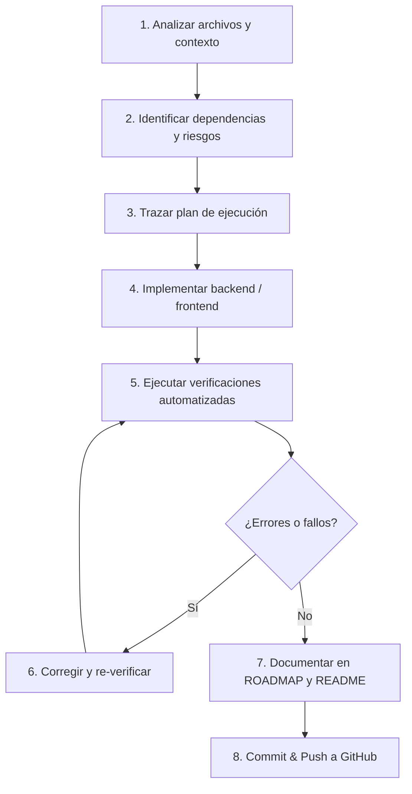

# 🤖 AGENTS.md — Manual de Operaciones e Instrucciones para Agentes de IA

> **Proyecto:** Paddock Manager — Sistema de Gestión Integral de Talleres Mecánicos  
> **Versión de Documentación:** 1.0.0  
> **Audiencia:** Cualquier modelo de IA o agente autónomo que intervenga en el ciclo de vida del repositorio.

---

## 1. Identidad y Propósito del Proyecto

**Paddock Manager** es una aplicación web Full Stack de nivel profesional diseñada para la **gestión integral de talleres mecánicos y centros de servicio automotriz**. Su arquitectura modela con fidelidad el flujo operativo de un taller en el mundo real:

```
[Recepción de Vehículo / Cita Previa]
               │
               ▼
   [Apertura de Orden de Trabajo] ──► (Generación de código anual secuencial ORD-YYYY-XXXX)
               │
               ▼
     [Diagnóstico Técnico] ─────────► (Hallazgos, síntomas, averías y recomendaciones)
               │
               ▼
    [Presupuestación al Cliente] ───► (Desglose de mano de obra y piezas, cálculo de IVA 21%)
               │
        ┌──────┴──────┐
   (Aprobado)    (Rechazado)
        │             │
        ▼             ▼
[Reparación Activa] [Cierre / Cancelación]
        │
        ▼ (Consumo y control de stock de piezas)
[Control de Inventario]
        │
        ▼
[Finalización y Entrega]
```

La aplicación no es una maqueta ni una demo superficial: es un sistema con **lógica de negocio estricta, validaciones transaccionales, auditoría inmutable de estados y seguridad basada en roles (RBAC)**.

---

## 2. Stack Tecnológico Real y Verificado

Cualquier cambio o desarrollo debe ceñirse a las tecnologías y versiones reales utilizadas en el repositorio:

| Componente | Tecnología | Versión | Rol en el Sistema |
| :--- | :--- | :--- | :--- |
| **Lenguaje Backend** | Java (OpenJDK) | **17** | Lenguaje tipado backend |
| **Framework Backend** | Spring Boot | **3.3.4** | Inversión de control, REST API, JPA |
| **Seguridad Backend** | Spring Security + JJWT | **6.x / 0.12.6** | Autenticación stateless y control de acceso (RBAC) |
| **Persistencia** | Spring Data JPA / Hibernate | **6.5.3** | Mapeo objeto-relacional y repositorios |
| **Base de Datos Principal** | PostgreSQL (Docker) | **16-alpine** | Base de datos relacional transaccional |
| **Base de Datos Tests** | H2 Database (In-Memory) | **2.2.x** | Ejecución de tests en perfil `test` |
| **Documentación API** | SpringDoc OpenAPI / Swagger | **2.6.0** | Documentación viva de endpoints (`/swagger-ui.html`) |
| **Framework Frontend** | Angular (Standalone Components) | **18.2.0** | SPA moderna sin `NgModule` |
| **Gestión de Estado UI** | Angular Signals (`signal`, `computed`) | **18.2.0** | Reactividad granular sin dependencias externas pesadas |
| **Iconografía UI** | Lucide Angular + Unicode nativo | **0.453.0** | Iconografía y componentes visuales |
| **Estilos UI** | SCSS nativo + Variables CSS | **-** | Sistema de diseño profesional Slate/Paddock Red |
| **Virtualización Local** | Docker & Docker Compose | **Compose v2** | Servicio `paddock-postgres` en puerto `5432` |

---

## 3. Arquitectura y Organización del Espacio de Trabajo

El proyecto está estructurado como un monorepositorio con separación clara entre backend, frontend y base de datos:

```
paddock-manager/
├── AGENTS.md                  # Este manual de instrucciones para agentes
├── ARCHITECTURE.md            # Documento técnico detallado de arquitectura real
├── ROADMAP.md                 # Estado real y seguimiento de las 19 fases
├── README.md                  # Presentación general y guía rápida
├── docker-compose.yml         # Contenedor de PostgreSQL 16
├── database/
│   └── init/
│       ├── 01-schema.sql      # DDL relacional (13 tablas, restricciones e índices)
│       └── 02-seed-data.sql   # Datos semilla para pruebas locales
├── backend/                   # Proyecto Maven Spring Boot 3
│   ├── pom.xml
│   ├── mvnw.cmd / mvnw
│   └── src/
│       ├── main/
│       │   ├── java/com/paddock/manager/
│       │   │   ├── common/    # ApiResponse, ApiErrorResponse, excepciones globales
│       │   │   ├── config/    # SecurityConfig, CorsConfig, OpenApiConfig, JpaAuditing
│       │   │   ├── security/  # JwtService, JwtFilter, CustomUserDetailsService
│       │   │   └── modules/   # Paquetes verticales por dominio (DDD)
│       │   │       ├── appointment/
│       │   │       ├── auth/
│       │   │       ├── budget/
│       │   │       ├── customer/
│       │   │       ├── diagnosis/
│       │   │       ├── health/
│       │   │       ├── part/
│       │   │       ├── repairorder/
│       │   │       ├── user/
│       │   │       └── vehicle/
│       │   └── resources/     # application.yml, application-dev.yml
│       └── test/              # Tests de integración JUnit 5 + MockMvc
└── frontend/                  # Proyecto Angular 18 Standalone
    ├── package.json
    ├── angular.json
    └── src/
        └── app/
            ├── core/          # Modelos TypeScript, Guards, Interceptors, Servicios HTTP
            ├── features/      # Componentes de páginas por módulo
            └── shared/        # Componentes comunes (Header, Sidebar)
```

### ¿Dónde debe trabajar el agente?
- **Cambios en lógica de negocio o endpoints:** Exclusivamente en `backend/src/main/java/com/paddock/manager/modules/<modulo>/`.
- **Nuevas pruebas backend:** En `backend/src/test/java/com/paddock/manager/<Modulo>ControllerTest.java`.
- **Servicios o modelos frontend:** En `frontend/src/app/core/services/` y `frontend/src/app/core/models/`.
- **Vistas y componentes frontend:** En `frontend/src/app/features/<modulo>/`.
- **Scripts de base de datos:** En `database/init/`.

---

## 4. Normas de Programación Obligatorias

### 4.1 Backend (Java / Spring Boot)
1. **Arquitectura en capas estricta dentro de cada módulo:**
   - `entity/`: Entidades JPA con anotaciones de Hibernate, claves primarias `@GeneratedValue(strategy = GenerationType.IDENTITY)` y auditoría `@CreationTimestamp` / `@UpdateTimestamp`.
   - `dto/`: Clases independientes para requests y responses. **Nunca exponer entidades JPA directamente en los controladores**.
   - `repository/`: Interfaces `JpaRepository` con consultas `@Query` optimizadas.
   - `service/`: Interfaz de servicio + implementación (`ServiceImpl`) anotada con `@Service` y `@Transactional`.
   - `controller/`: REST Controller documentado con anotaciones Swagger (`@Tag`, `@Operation`) y protegido con `@PreAuthorize`.
   - `mapper/`: Métodos estáticos puros para convertir de Entity a DTO y viceversa (sin magia opaca).
2. **Uso obligatorio del envoltorio uniforme `ApiResponse<T>`:**
   Todas las respuestas exitosas deben devolverse como `ResponseEntity.ok(ApiResponse.success(data))` o `ResponseEntity.status(HttpStatus.CREATED).body(ApiResponse.success(mensaje, data))`.
3. **Gestión centralizada de excepciones:**
   - Lanzar `ResourceNotFoundException` para recursos inexistentes (produce HTTP 404).
   - Lanzar `BusinessException` para violaciones de reglas de negocio (produce HTTP 422 Unprocessable Entity).
   - Lanzar `BadRequestException` para parámetros o estados incoherentes (produce HTTP 400).
   - Las validaciones de Bean Validation (`@NotNull`, `@NotBlank`, `@Min`, etc.) son capturadas automáticamente por `GlobalExceptionHandler` devolviendo HTTP 400 con mapa detallado de campos con error.
4. **Seguridad y roles:**
   - La API está protegida por defecto (`.anyRequest().authenticated()`).
   - Solo `/api/auth/**`, `/api/health` y `/swagger-ui/**` son públicos.
   - Todo endpoint de mutación (`POST`, `PUT`, `PATCH`, `DELETE`) debe contar con `@PreAuthorize("hasRole(...)")` o `@PreAuthorize("hasAnyRole(...)")`.
5. **Compatibilidad de dialectos SQL (PostgreSQL vs H2):**
   - **Regla crítica descubierta en producción:** En JPQL, **nunca** utilizar `LOWER(CONCAT('%', :search, '%'))` con parámetros opcionales. El driver JDBC de PostgreSQL interpreta el parámetro como `bytea`, fallando con el error `function lower(bytea) does not exist`.
   - **Solución estándar:** Precomputar el patrón de búsqueda en el Service en Java:  
     `String pattern = "%" + search.trim().toLowerCase() + "%";`  
     y enlazar directamente en la consulta JPQL: `LOWER(e.campo) LIKE :pattern`.

### 4.2 Frontend (Angular 18 Standalone)
1. **Cero `NgModule`:** Todos los componentes, directivas y pipes son `standalone: true`.
2. **Reactividad moderna con Signals:** Utilizar `signal()`, `computed()` y `effect()`. Evitar suscripciones manuales innecesarias o variables mutables sin control de cambio.
3. **Flujo de control nativo:** Utilizar la nueva sintaxis `@if`, `@else`, `@for (item of items; track item.id)`, `@empty`. No utilizar directivas obsoletas `*ngIf` o `*ngFor`.
4. **Formularios reactivos con tipado estricto:** Utilizar `FormBuilder`, `FormGroup` y `Validators`. Validar en el cliente antes de emitir la petición HTTP.
5. **Inyección de dependencias funcional:** Utilizar `inject(Service)` en lugar de constructores verbosos con inyecciones públicas.
6. **Diseño y estilos:**
   - Usar el sistema de diseño centralizado definido en `frontend/src/styles.scss`.
   - Emplear las variables CSS existentes (`--primary`, `--card-bg`, `--card-border`, `--text-main`, `--text-muted`, etc.).
   - No introducir librerías de estilos pesadas (como Bootstrap completo o Tailwind) que rompan la coherencia del diseño actual.

---

## 5. Normas de Desarrollo para Agentes

1. **Lectura previa obligatoria:** Antes de escribir una sola línea de código, lee los archivos existentes del módulo afectado y módulos análogos para mantener estilos, patrones y convenciones.
2. **No romper código existente:** Cada cambio debe preservar la compatibilidad regresiva con los módulos ya completados (Customer, Vehicle, Appointment, RepairOrder, Diagnosis, Budget, Part).
3. **Cero datos ficticios (mocks en código productivo):** No crear datos mockeados en memoria dentro de los componentes para fingir que una pantalla funciona. Los componentes deben conectarse a sus respectivos servicios HTTP contra el backend.
4. **No dejar código a medias:** Queda terminantemente prohibido dejar métodos vacíos (`// TODO`), `return null` o comentarios marcando funcionalidades futuras como si estuvieran terminadas.
5. **No introducir dependencias innecesarias:** No añadir librerías en `pom.xml` o `package.json` a menos que sea estrictamente indispensable y justificado.
6. **Mantenimiento del control de versiones (Git):**
   - El usuario ha establecido la directiva fija: **"avanza y sube siempre todos los cambios a github"**.
   - Tras completar y verificar cualquier hito, se deben añadir los archivos (`git add -A`), hacer commit descriptivo y realizar push a la rama `main` (`git push origin main`).

---

## 6. Protocolo de Trabajo Obligatorio por Tarea

Cualquier agente debe ejecutar rigurosamente este protocolo de 8 pasos:



1. **Analizar:** Inspeccionar entidades, DTOs, mappers, servicios, componentes y rutas relacionadas.
2. **Evaluar riesgos:** Verificar si el cambio altera contratos de API existentes, migraciones de base de datos o comportamientos esperados en el frontend.
3. **Planificar:** Presentar al usuario o registrar en el plan los pasos concretos de la intervención.
4. **Desarrollar:** Escribir el código cumpliendo las normas de arquitectura y tipado.
5. **Verificar:**
   - Backend: Ejecutar `cd backend; .\mvnw.cmd test` y comprobar que **todas las pruebas pasan (`BUILD SUCCESS`)**.
   - Frontend: Ejecutar `cd frontend; npm run build` y comprobar que el bundle compila con **0 errores de TypeScript**.
6. **Corregir:** Si un test o la compilación falla, analizar el error raíz, resolverlo y repetir la verificación hasta obtener verde total.
7. **Documentar:** Actualizar `ROADMAP.md` y `README.md` reflejando el progreso verificado.
8. **Publicar:** Confirmar cambios con `git commit` y subir con `git push origin main`.

---

## 7. Criterios de Calidad y Clasificación de Estado

Para garantizar que el repositorio refleje la realidad exacta del software, los agentes deben utilizar rigurosamente los siguientes estados tanto en sus respuestas como en `ROADMAP.md`:

- **`IMPLEMENTADO` / `COMPLETADA`:** La funcionalidad está desarrollada en backend y frontend, integrada mediante servicios HTTP, compilada sin errores y verificada mediante tests automatizados o pruebas en vivo.
- **`PARCIAL`:** Existe implementación de backend o frontend, pero falta integración, sub-funcionalidades esenciales o pruebas.
- **`PROVISIONAL`:** Existe estructura visual o maquetado con datos estáticos (mockup), pero sin funcionalidad real conectada al backend.
- **`PENDIENTE`:** No se ha iniciado el desarrollo.
- **`NO VERIFICADO`:** El código existe, pero no ha podido ser comprobado mediante ejecución de pruebas o compilación.

> ⚠️ **Regla de Oro:** Ninguna tarea se marca como completada por el mero hecho de haber creado los archivos. Debe estar implementada, integrada y comprobada.
