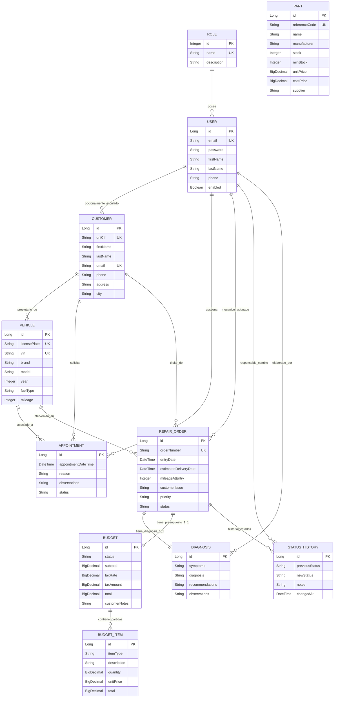

# 🏛️ ARCHITECTURE.md — Documento de Arquitectura de Software

> **Proyecto:** Paddock Manager  
> **Versión del Sistema:** 0.0.1-SNAPSHOT (Fase 13 Completada)  
> **Fecha:** Noviembre de 2026  
> **Autor / Arquitecto:** Raúl Esteban

---

## 1. Visión General del Sistema

**Paddock Manager** es una plataforma de software empresarial Full Stack orientada a la **gestión integral y operativa de talleres mecánicos de automoción**. El sistema centraliza todas las actividades operativas del taller:

1. **Recepción y Agenda:** Gestión de clientes, parque de vehículos y programación de citas con control algorítmico de solapamientos.
2. **Operación de Taller:** Apertura de órdenes de reparación con identificador único anual (`ORD-YYYY-XXXX`), asignación de mecánicos y máquina de estados con auditoría inmutable en `status_history`.
3. **Inspección Técnica:** Diagnósticos detallados vinculados 1:1 con la orden (síntomas, averías, recomendaciones y seguridad).
4. **Presupuestación:** Desglose de partidas (mano de obra, recambios, diagnosis), cálculo exacto de IVA (21%) y sincronización bidireccional de estados de orden ante la aprobación o rechazo del cliente.
5. **Inventario y Recambios:** Catálogo de piezas con referencia única, ajustes rápidos de existencias con **bloqueo estricto contra stock negativo**, alertas automáticas de reposición (`lowStock`) y valoración financiera del almacén (coste y venta).

El diseño prioriza la **separación estricta de responsabilidades**, la **seguridad sin estado basada en JWT con control de acceso por roles (RBAC)** y la **máxima mantenibilidad y escalabilidad**.

---

## 2. Stack Tecnológico Real y Dependencias

```
┌─────────────────────────────────────────────────────────────┐
│                    FRONTEND (SPA)                           │
│   Angular 18.2.0 (Standalone) · TypeScript 5.5.2 · SCSS     │
│   Angular Signals · Lucide Icons · Reactive Forms · RxJS    │
└──────────────────────────────┬──────────────────────────────┘
                               │ HTTPS / JSON (REST API)
                               │ Authorization: Bearer <JWT>
┌──────────────────────────────▼──────────────────────────────┐
│                    BACKEND (REST API)                       │
│   Java 17 (OpenJDK) · Spring Boot 3.3.4                     │
│   Spring Security 6 (Stateless JWT JJWT 0.12.6)             │
│   Spring Data JPA (Hibernate 6.5.3) · SpringDoc OpenAPI 2.6 │
│   Lombok · Bean Validation (Jakarta Validation)             │
└──────────────────────────────┬──────────────────────────────┘
                               │ JDBC / PostgreSQL Dialect
┌──────────────────────────────▼──────────────────────────────┐
│                   PERSISTENCIA DE DATOS                     │
│   PostgreSQL 16-alpine (Docker Compose en :5432)            │
│   H2 In-Memory Database (Modo PostgreSQL para Testing)      │
└─────────────────────────────────────────────────────────────┘
```

### Detalle de dependencias principales en `pom.xml`:
- `org.springframework.boot:spring-boot-starter-web`: Servidor Tomcat embebido y controladores MVC REST.
- `org.springframework.boot:spring-boot-starter-data-jpa`: Capa de persistencia con Hibernate ORM y Spring Data Repositories.
- `org.springframework.boot:spring-boot-starter-validation`: Bean Validation (Jakarta) para validación declarativa en DTOs.
- `org.springframework.boot:spring-boot-starter-security`: Filtros de seguridad, autenticación y autorización por método.
- `io.jsonwebtoken:jjwt-api`, `jjwt-impl`, `jjwt-jackson` (0.12.6): Generación, firmado y validación criptográfica de tokens JWT.
- `org.postgresql:postgresql`: Driver JDBC oficial para PostgreSQL.
- `org.springdoc:springdoc-openapi-starter-webmvc-ui` (2.6.0): Swagger UI interactivo y documentación viva OpenAPI 3.
- `org.projectlombok:lombok`: Reducción de código boilerplate (Getters, Setters, Builders, Constructores).
- `com.h2database:h2`: Motor en memoria aislado para pruebas unitarias e integración con perfil `test`.

---

## 3. Arquitectura Backend (Spring Boot 3)

El backend sigue los principios de **Domain-Driven Design (DDD) modular** estructurado por paquetes verticales. Cada módulo funcional es autónomo y encapsula su propio ciclo de vida.

### 3.1 Estructura de Paquetes
```
com.paddock.manager/
├── PaddockManagerApplication.java    # Punto de entrada (@SpringBootApplication)
├── common/                           # Elementos transversales reutilizables
│   ├── exception/
│   │   ├── BadRequestException.java        # HTTP 400
│   │   ├── BusinessException.java          # HTTP 422 (Reglas de negocio)
│   │   ├── GlobalExceptionHandler.java     # @RestControllerAdvice centralizado
│   │   └── ResourceNotFoundException.java  # HTTP 404
│   └── response/
│       ├── ApiErrorResponse.java           # Esquema JSON estandarizado para errores
│       └── ApiResponse.java                # Envoltorio uniforme success/message/data
├── config/                           # Configuraciones de infraestructura
│   ├── CorsConfig.java                     # Orígenes cruzados para Angular
│   ├── JpaAuditingConfig.java              # @EnableJpaAuditing
│   └── OpenApiConfig.java                  # Metadatos OpenAPI y esquema BearerAuth
├── security/                         # Implementación de seguridad stateless
│   ├── CustomUserDetailsService.java       # Carga de usuarios desde PostgreSQL
│   ├── JwtAuthenticationEntryPoint.java    # Manejo de error 401 Unauthorized
│   ├── JwtAuthenticationFilter.java        # Filtro OncePerRequestFilter para JWT
│   ├── JwtService.java                     # Generación y validación de tokens
│   └── SecurityConfig.java                 # Configuración de SecurityFilterChain
└── modules/                          # Módulos verticales de dominio
    ├── appointment/                  # Citas de taller y control de disponibilidad
    ├── auth/                         # Autenticación, login y /me
    ├── budget/                       # Presupuestos, partidas y cálculo de IVA
    ├── customer/                     # Clientes particulares y empresas
    ├── diagnosis/                    # Diagnósticos de averías e inspecciones
    ├── health/                       # Verificación de salud del servicio (/api/health)
    ├── part/                         # Inventario, piezas, ajustes y valoración de stock
    ├── repairorder/                  # Órdenes de trabajo, máquina de estados y timeline
    ├── user/                         # Usuarios de sistema y roles
    └── vehicle/                      # Vehículos, VIN y vinculación de propietarios
```

### 3.2 Patrón Arquitectónico en cada Módulo
Cada módulo implementa rigurosamente el siguiente flujo unidireccional:

```
[HTTP Request] 
      │
      ▼
[Controller]  <── Valida DTO (@Valid) y autoriza por rol (@PreAuthorize)
      │
      ▼
  [Service]   <── Ejecuta reglas de negocio, transacciones (@Transactional)
      │
      ├──► [Mapper]      (Transforma DTOs a Entidades y viceversa)
      └──► [Repository]  (Spring Data JPA / Consultas JPQL optimizadas)
                 │
                 ▼
          [PostgreSQL DB]
```

1. **Entities:** Anotadas con `@Entity`, `@Table`, `@Id`, `@GeneratedValue(strategy = GenerationType.IDENTITY)`. Usan `@CreationTimestamp` y `@UpdateTimestamp`.
2. **DTOs:** Separación estricta entre `*RequestDto` (datos de entrada validados con Bean Validation) y `*ResponseDto` (datos proyectados para el cliente).
3. **Mappers:** Clases de utilidad con métodos estáticos explícitos (`toDto()`, `toEntity()`). No se utilizan frameworks de reflexión como ModelMapper o MapStruct para garantizar transparencia y control de errores en tiempo de compilación.
4. **Repositories:** Extienden `JpaRepository<Entity, Long>`. Emplean consultas JPQL con `@Param` o `@EntityGraph` para evitar problemas de N+1 y `LazyInitializationException`.
5. **Services:** Definidos mediante interfaz (`PartService`) e implementación concreta (`PartServiceImpl`). Toda modificación transaccional está respaldada por `@Transactional`.

---

## 4. Arquitectura Frontend (Angular 18 Standalone)

El frontend es una Single Page Application (SPA) moderna desarrollada con la arquitectura Standalone de Angular 18, eliminando los módulos tradicionales (`NgModule`) en favor de componentes ligeros, componibles y orientados a rendimiento.

### 4.1 Estructura de Directorios
```
frontend/src/app/
├── app.component.ts / .html / .scss  # Layout raíz
├── app.config.ts                     # provideHttpClient, provideRouter, interceptors
├── app.routes.ts                     # Definición de rutas y asignación de Guards
├── core/                             # Lógica no visual y singleton
│   ├── guards/
│   │   └── auth.guard.ts             # authGuard y guestGuard
│   ├── interceptors/
│   │   └── auth.interceptor.ts       # Inyección de cabecera Bearer y captura de 401
│   ├── models/                       # Interfaces TypeScript fuertemente tipadas
│   │   ├── api-response.model.ts     # ApiResponse<T>, Page<T>, ApiErrorResponse
│   │   ├── appointment.model.ts
│   │   ├── auth.model.ts
│   │   ├── budget.model.ts
│   │   ├── customer.model.ts
│   │   ├── diagnosis.model.ts
│   │   ├── part.model.ts
│   │   ├── repair-order.model.ts
│   │   └── vehicle.model.ts
│   └── services/                     # Servicios HTTP encapsulados por dominio
│       ├── appointment.service.ts
│       ├── auth.service.ts           # Gestión de sesión con Signals (currentUser, role)
│       ├── budget.service.ts
│       ├── customer.service.ts
│       ├── diagnosis.service.ts
│       ├── part.service.ts
│       ├── repair-order.service.ts
│       └── vehicle.service.ts
├── features/                         # Vistas y pantallas funcionales
│   ├── appointments/                 # Gestión de citas
│   ├── auth/login/                   # Pantalla de acceso
│   ├── budgets/                      # Gestión de presupuestos e impresión
│   ├── customers/                    # Directorio de clientes
│   ├── dashboard/                    # Panel de control de taller (actualmente maqueta)
│   ├── diagnoses/                    # Ficha de diagnóstico técnico
│   ├── inventory/                    # Inventario, repuestos y ajuste de stock
│   ├── repair-orders/                # Tablero de órdenes y timeline
│   └── vehicles/                     # Catálogo de vehículos
└── shared/                           # Componentes visuales comunes
    └── components/
        ├── header/                   # Barra superior con datos de usuario y logout
        └── sidebar/                  # Menú de navegación colapsable reactivo
```

### 4.2 Gestión de Estado con Angular Signals
El proyecto utiliza la API nativa de **Angular Signals** para el estado reactivo:
- En `AuthService`: `token = signal<string | null>(...)`, `currentUser = signal<AuthResponse | null>(...)`.
- Señales derivadas con `computed()`: `isAuthenticated = computed(() => !this.token())`, `isAdmin = computed(...)`, `isMechanic = computed(...)`.
- En componentes de vista (`InventoryComponent`, `BudgetsComponent`, `RepairOrdersComponent`):
  - `loading = signal<boolean>(false)`
  - `items = signal<T[]>([])`
  - `totalElements = signal<number>(0)`
  - `resultingStock = computed(...)` para cálculos automáticos en tiempo real.

---

## 5. Base de Datos Relacional (PostgreSQL 16)

La base de datos se inicializa automáticamente al arrancar el contenedor Docker mediante los scripts en [`database/init/`](file:///c:/Users/rauly/Desktop/Paddock%20Manager/database/init/).

### 5.1 Tablas del Esquema DDL (13 tablas)

1. **`roles`**: Catálogo de roles de usuario del sistema (`ROLE_ADMIN`, `ROLE_RECEPTIONIST`, `ROLE_MECHANIC`, `ROLE_CUSTOMER`).
2. **`users`**: Usuarios con credenciales cifradas con BCrypt, nombre, email único y relación con rol.
3. **`customers`**: Clientes con DNI/CIF único, nombre, apellidos, email único, teléfono y dirección.
4. **`vehicles`**: Parque de vehículos con matrícula única, VIN único (17 caracteres), combustible (`CHECK`), año y kilometraje actual.
5. **`appointments`**: Citas programadas con cliente, vehículo, fecha/hora y estado (`PROGRAMADA`, `CONFIRMADA`, `EN_TALLER`, `COMPLETADA`, `CANCELADA`).
6. **`repair_orders`**: Órdenes de trabajo con código secuencial único `ORD-YYYY-XXXX`, cliente, vehículo, mecánico asignado, kilometraje de entrada, prioridad y estado (`RECEIVED`, `DIAGNOSIS`, `QUOTE_PENDING`, `APPROVED`, `IN_REPAIR`, `WAITING_FOR_PARTS`, `COMPLETED`, `DELIVERED`, `CANCELLED`).
7. **`diagnoses`**: Ficha técnica de diagnosis vinculada 1:1 con `repair_orders` (síntomas, diagnóstico, recomendaciones).
8. **`budgets`**: Presupuestos vinculados 1:1 con `repair_orders`, con subtotal, tipo de IVA (21%), importe de IVA, total y estado (`PENDING`, `APPROVED`, `REJECTED`).
9. **`budget_items`**: Partidas desglosadas vinculadas a un presupuesto (tipo `LABOR`, `PART`, `DIAGNOSIS`, `OTHER`, cantidad, precio unitario y total).
10. **`parts`**: Catálogo de recambios con código de referencia único, fabricante, proveedor, stock, stock mínimo, precio coste y precio venta.
11. **`repair_order_parts`**: Registro de piezas físicas aplicadas en una orden de reparación.
12. **`work_logs`**: Imputación de horas de mano de obra por mecánico en una orden de trabajo.
13. **`status_history`**: Registro inmutable de auditoría para cada cambio de estado de una orden (estado anterior, nuevo estado, usuario responsable, notas y fecha).

### 5.2 Correspondencia entre Tablas SQL y Entidades JPA
- **11 tablas mapeadas activamente a Entidades JPA:** `roles` (`Role`), `users` (`User`), `customers` (`Customer`), `vehicles` (`Vehicle`), `appointments` (`Appointment`), `repair_orders` (`RepairOrder`), `diagnoses` (`Diagnosis`), `budgets` (`Budget`), `budget_items` (`BudgetItem`), `parts` (`Part`), `status_history` (`StatusHistory`).
- **2 tablas definidas en DDL pero pendientes de Entidad JPA:** `repair_order_parts` y `work_logs` (reservadas para el módulo de imputación directa de horas y consumos de orden).

---

## 6. Modelo Entidad-Relación (Mermaid)

El siguiente diagrama refleja **exclusivamente las entidades JPA y relaciones reales existentes en el código Java del backend**:



---

## 7. Seguridad y Control de Acceso (RBAC)

### 7.1 Autenticación y Ciclo del JWT
1. El cliente envía `POST /api/auth/login` con email y contraseña.
2. `AuthenticationManager` valida las credenciales contra `CustomUserDetailsService` con `BCryptPasswordEncoder`.
3. Si la verificación es exitosa, `JwtService` emite un token con algoritmo HMAC-SHA256, validez de 24 horas y claims:
   - `sub`: email del usuario.
   - `userId`: ID numérico de la entidad `User`.
   - `fullName`: Nombre y apellidos para la UI.
   - `role`: Nombre canónico del rol (`ROLE_ADMIN`, `ROLE_RECEPTIONIST`, `ROLE_MECHANIC`, `ROLE_CUSTOMER`).
4. En cada petición posterior, `JwtAuthenticationFilter` extrae el token de la cabecera `Authorization: Bearer <token>`, valida la firma y establece el `UsernamePasswordAuthenticationToken` en el `SecurityContextHolder`.

### 7.2 Matriz de Roles y Permisos en Endpoints

| Módulo / Recurso | Endpoint | Método | Roles Permitidos |
| :--- | :--- | :---: | :--- |
| **Autenticación** | `/api/auth/login` | `POST` | *Público (PermitAll)* |
| **Autenticación** | `/api/auth/me` | `GET` | Autenticado (Cualquier rol) |
| **Salud** | `/api/health` | `GET` | *Público (PermitAll)* |
| **Documentación** | `/swagger-ui/**`, `/v3/api-docs/**` | `GET` | *Público (PermitAll)* |
| **Clientes** | `/api/customers` | `GET` | `ADMIN`, `RECEPTIONIST`, `MECHANIC` |
| **Clientes** | `/api/customers` | `POST`, `PUT` | `ADMIN`, `RECEPTIONIST` |
| **Clientes** | `/api/customers/{id}` | `DELETE` | `ADMIN` |
| **Vehículos** | `/api/vehicles` | `GET` | `ADMIN`, `RECEPTIONIST`, `MECHANIC` |
| **Vehículos** | `/api/vehicles` | `POST`, `PUT` | `ADMIN`, `RECEPTIONIST` |
| **Vehículos** | `/api/vehicles/{id}` | `DELETE` | `ADMIN` |
| **Citas** | `/api/appointments` | `GET` | `ADMIN`, `RECEPTIONIST`, `MECHANIC` |
| **Citas** | `/api/appointments` | `POST`, `PUT`, `/cancel` | `ADMIN`, `RECEPTIONIST` |
| **Citas** | `/api/appointments/{id}/status`| `PATCH` | `ADMIN`, `RECEPTIONIST`, `MECHANIC` |
| **Citas** | `/api/appointments/{id}` | `DELETE` | `ADMIN` |
| **Órdenes de Trabajo**| `/api/repair-orders` | `GET` | `ADMIN`, `RECEPTIONIST`, `MECHANIC` |
| **Órdenes de Trabajo**| `/api/repair-orders` | `POST`, `PUT`, `/assign-mechanic` | `ADMIN`, `RECEPTIONIST` |
| **Órdenes de Trabajo**| `/api/repair-orders/{id}/status` | `PATCH` | `ADMIN`, `RECEPTIONIST`, `MECHANIC` |
| **Órdenes de Trabajo**| `/api/repair-orders/{id}` | `DELETE` | `ADMIN` |
| **Diagnósticos** | `/api/diagnoses` | `GET` | `ADMIN`, `RECEPTIONIST`, `MECHANIC` |
| **Diagnósticos** | `/api/diagnoses` | `POST`, `PUT` | `ADMIN`, `MECHANIC` |
| **Diagnósticos** | `/api/diagnoses/{id}` | `DELETE` | `ADMIN` |
| **Presupuestos** | `/api/budgets` | `GET` | `ADMIN`, `RECEPTIONIST`, `MECHANIC`, `CUSTOMER` |
| **Presupuestos** | `/api/budgets` | `POST`, `PUT` | `ADMIN`, `RECEPTIONIST` |
| **Presupuestos** | `/api/budgets/{id}/status` | `PATCH` | `ADMIN`, `RECEPTIONIST`, `CUSTOMER` |
| **Presupuestos** | `/api/budgets/{id}` | `DELETE` | `ADMIN` |
| **Inventario** | `/api/parts` | `GET`, `/by-reference/**` | `ADMIN`, `RECEPTIONIST`, `MECHANIC` |
| **Inventario** | `/api/parts/stats` | `GET` | `ADMIN`, `RECEPTIONIST` |
| **Inventario** | `/api/parts` | `POST`, `PUT` | `ADMIN`, `RECEPTIONIST` |
| **Inventario** | `/api/parts/{id}/stock` | `PATCH` | `ADMIN`, `RECEPTIONIST`, `MECHANIC` |
| **Inventario** | `/api/parts/{id}` | `DELETE` | `ADMIN` |

---

## 8. Infraestructura Local y Despliegue con Docker

### 8.1 Contenedor de Base de Datos
El archivo `docker-compose.yml` en la raíz gestiona el servicio de persistencia:

```yaml
services:
  postgres:
    image: postgres:16-alpine
    container_name: paddock-postgres
    restart: unless-stopped
    env_file:
      - .env
    environment:
      POSTGRES_DB: ${POSTGRES_DB}
      POSTGRES_USER: ${POSTGRES_USER}
      POSTGRES_PASSWORD: ${POSTGRES_PASSWORD}
    ports:
      - "${POSTGRES_PORT:-5432}:5432"
    volumes:
      - postgres_data:/var/lib/postgresql/data
      - ./database/init:/docker-entrypoint-initdb.d:ro
    healthcheck:
      test: ["CMD-SHELL", "pg_isready -U ${POSTGRES_USER} -d ${POSTGRES_DB}"]
      interval: 10s
      timeout: 5s
      retries: 5
```

### 8.2 Variables de Entorno (`.env`)
- `POSTGRES_DB=paddock_db`
- `POSTGRES_USER=paddock_user`
- `POSTGRES_PASSWORD=paddock_secure_pass_2026`
- `POSTGRES_PORT=5432`

---

## 9. Estrategia de Testing

El proyecto cuenta con una sólida batería de pruebas de integración con `@SpringBootTest` y `MockMvc` utilizando una base de datos en memoria H2 con dialecto PostgreSQL (`MODE=PostgreSQL`).

### 9.1 Clases de Test Existentes (57 pruebas verdes):
1. `AppointmentControllerTest` (6 tests): creación, validación de conflicto de horarios, cambios de estado y cancelación.
2. `AuthControllerTest` (6 tests): login exitoso, credenciales inválidas, usuario deshabilitado y consulta `/me`.
3. `BudgetControllerTest` (6 tests): emisión de presupuesto, desglose de partidas, cálculo de IVA, aprobación y rechazo.
4. `CustomerControllerTest` (7 tests): alta, duplicidad de DNI, duplicidad de email, búsqueda paginada y borrado.
5. `DiagnosisControllerTest` (6 tests): registro de diagnosis 1:1, validación de pertenencia a orden y actualización.
6. `HealthControllerTest` (1 test): disponibilidad del endpoint `/api/health`.
7. `PaddockManagerApplicationTests` (1 test): verificación de carga correcta del contexto de Spring.
8. `PartControllerTest` (8 tests): alta de repuesto, referencia duplicada, ajustes de stock positivos/negativos, rechazo de stock negativo, filtro de stock bajo y estadísticas.
9. `RepairOrderControllerTest` (8 tests): generación de código anual `ORD-YYYY-XXXX`, transiciones de la máquina de estados y asignación de mecánico.
10. `VehicleControllerTest` (9 tests): validación de bastidor VIN de 17 caracteres, matrícula única y filtrado por cliente.

### 9.2 Ejecución de Pruebas
```bash
# Ejecutar todas las pruebas del backend
cd backend
.\mvnw.cmd test

# Compilar frontend para verificar tipado y plantillas
cd frontend
npm run build
```

---

## 10. Convenciones para Añadir Nuevos Módulos

Para incorporar un nuevo módulo al sistema sin romper la arquitectura existente, se debe seguir este procedimiento:

1. **Definir la Entidad JPA:** Crear `modules/<nombre>/entity/<Nombre>.java` extendiendo auditoría o con campos de marca temporal.
2. **Crear Repositorio:** Crear `modules/<nombre>/repository/<Nombre>Repository.java` extendiendo `JpaRepository`.
   - *Nota importante:* Para búsquedas con texto, precomputar el patrón en el servicio (`String pattern = "%" + search.toLowerCase() + "%"`) y enlazar `LOWER(e.campo) LIKE :pattern` para evitar problemas con PostgreSQL JDBC y `bytea`.
3. **Crear DTOs:** Separar `*RequestDto` con validaciones Jakarta y `*ResponseDto`.
4. **Implementar Mapper:** Clase estática con métodos `toDto()` y `toEntity()`.
5. **Crear Servicio:** Interfaz `*Service` e implementación `*ServiceImpl` con `@Transactional`.
6. **Crear Controlador REST:** Con `@RestController`, `@RequestMapping("/api/<recurso>")`, anotaciones de Swagger y `@PreAuthorize`.
7. **Crear Pruebas de Integración:** `<Nombre>ControllerTest.java` en `backend/src/test/java/com/paddock/manager/`.
8. **Frontend:** Crear modelo TypeScript en `core/models/`, servicio en `core/services/` y componente Standalone en `features/`.

---

## 11. Limitaciones Conocidas y Deuda Técnica

1. **Módulo de Dashboard (Fase 14):** Actualmente el componente `dashboard.component.ts` tiene datos hardcodeados en el HTML/TS provenientes de la Fase 6. Requiere la creación de `modules/dashboard/` en el backend para suministrar estadísticas dinámicas agregadas.
2. **Entidades JPA pendientes de mapear:** Las tablas `repair_order_parts` y `work_logs` están creadas en el DDL de PostgreSQL (`01-schema.sql`), pero aún no cuentan con entidades JPA mapeadas en Java.
3. **Frontend Testing:** Actualmente no hay pruebas unitarias escritas con Jasmine/Karma para los componentes y servicios de Angular (solo el test por defecto `app.component.spec.ts`).
4. **Dockerización completa:** El archivo `docker-compose.yml` actual solo contiene PostgreSQL. Falta la definición de `Dockerfile` para el backend Spring Boot y para el frontend Angular con Nginx en contenedor.
