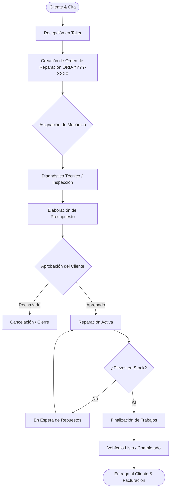
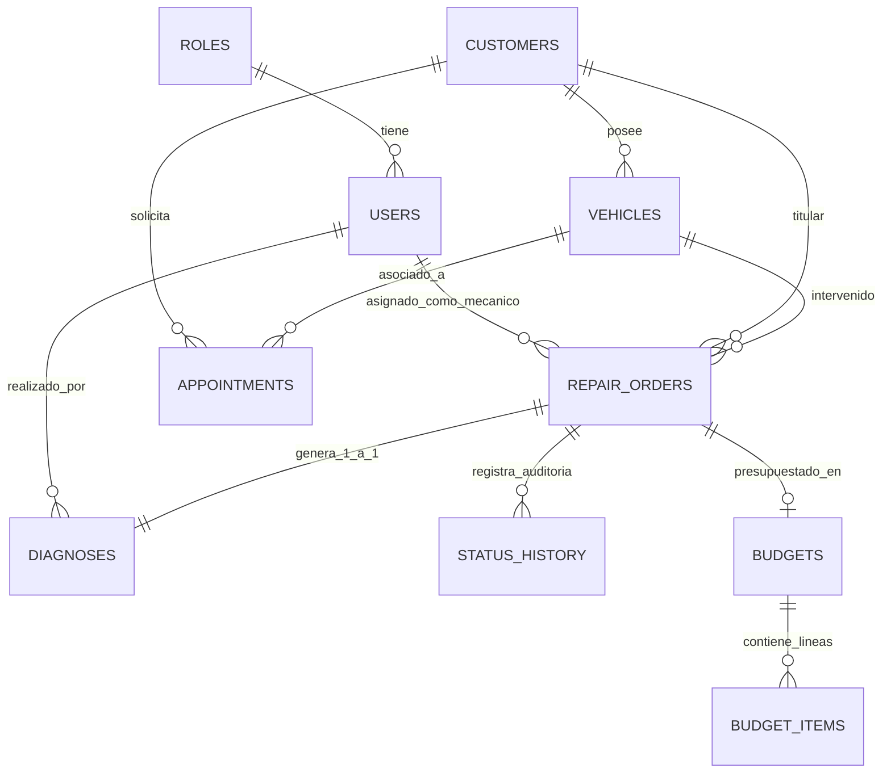

# 🏎️ Paddock Manager

[](https://www.oracle.com/java/)
[](https://spring.io/projects/spring-boot)
[](https://angular.dev/)
[](https://www.postgresql.org/)
[](https://www.docker.com/)
[](https://jwt.io/)
[](LICENSE)

> **Paddock Manager** es una plataforma web Full Stack profesional diseñada para la **gestión integral de talleres mecánicos y centros de servicio automotriz**. Modela fielmente el flujo de trabajo real de un taller: desde la recepción del vehículo, agendamiento de citas, apertura de órdenes de trabajo con auditoría, diagnóstico técnico de averías, presupuestación, hasta el control de inventario y entrega final.

Desarrollada como proyecto de referencia y portfolio Full Stack con arquitectura limpia, buenas prácticas de desarrollo (SOLID, DRY, DDD modular) y tecnologías modernas.

---

## 📑 Tabla de Contenidos

- [Flujo de Trabajo del Taller](#-flujo-de-trabajo-del-taller)
- [Módulos y Características](#-módulos-y-características)
- [Arquitectura del Sistema](#-arquitectura-del-sistema)
- [Stack Tecnológico](#-stack-tecnológico)
- [Modelo de Datos](#-modelo-de-datos)
- [Instalación y Puesta en Marcha](#-instalación-y-puesta-en-marcha)
- [Usuarios y Cuentas de Prueba](#-usuarios-y-cuentas-de-prueba)
- [Documentación de la API (Swagger)](#-documentación-de-la-api-swagger)
- [Estrategia de Pruebas](#-estrategia-de-pruebas)
- [Roadmap de Implementación](#-roadmap-de-implementación)
- [Autor](#-autor)

---

## 🔄 Flujo de Trabajo del Taller

La aplicación simula el ciclo de vida completo de un vehículo dentro de un taller mecánico:



---

## 🚀 Módulos y Características

### 1. Seguridad y Control de Acceso (RBAC + JWT)
- Autenticación sin estado basada en **JSON Web Tokens (JWT)** con cabecera `Authorization: Bearer <token>`.
- Control de acceso por roles (Role-Based Access Control):
  - **`ROLE_ADMIN`**: Control total del sistema (usuarios, clientes, vehículos, órdenes, presupuestos, inventario).
  - **`ROLE_RECEPTIONIST`**: Atención a clientes, gestión de vehículos, agenda de citas y apertura de órdenes.
  - **`ROLE_MECHANIC`**: Gestión de órdenes asignadas, registro de diagnósticos técnicos, piezas e imputación de horas.
  - **`ROLE_CUSTOMER`**: Consulta de citas, órdenes y presupuestos propios.
- Hash criptográfico de contraseñas con **BCrypt**.
- Interceptor HTTP en Angular para inyección transparente de token y guardias (`AuthGuard`, `GuestGuard`).

### 2. Gestión de Clientes (Customer Module)
- CRUD completo de clientes particulares y empresas (DNI / CIF, teléfono, email, dirección, localidad).
- Validación de unicidad de DNI/CIF y correo electrónico.
- Búsqueda en tiempo real por nombre, apellidos, documento de identidad o teléfono.
- Trazabilidad de vehículos asociados por cliente.

### 3. Parque de Vehículos (Vehicle Module)
- Registro y ficha técnica de vehículos asociados a clientes.
- Matrícula normalizada y validación estricta de formato **VIN / Número de Bastidor (17 caracteres)**.
- Clasificación por tipo de combustible (`GASOLINE`, `DIESEL`, `ELECTRIC`, `HYBRID`, `PLUG_IN_HYBRID`, `LPG`, `CNG`).
- Control y actualización progresiva de kilometraje en cada intervención.

### 4. Sistema de Citas (Appointments Module)
- Agendamiento de citas con fecha, hora de inicio y duración estimada.
- **Prevención de solapamiento**: Validación algorítmica para evitar conflictos de horario en el taller.
- Estados de cita: `SCHEDULED`, `CONFIRMED`, `IN_PROGRESS`, `COMPLETED`, `CANCELLED`, `NO_SHOW`.
- Filtrado por rango de fechas, cliente o estado, e indicadores clave (KPIs) en tiempo real.

### 5. Órdenes de Reparación (Repair Orders Module)
- Generación automática de identificador secuencial único anual: `ORD-YYYY-XXXX` (ej. `ORD-2026-0001`).
- Máquina de estados robusta:
  `RECEIVED` ➔ `DIAGNOSIS` ➔ `QUOTE_PENDING` ➔ `APPROVED` ➔ `IN_REPAIR` ➔ `WAITING_FOR_PARTS` ➔ `COMPLETED` ➔ `DELIVERED` (o `CANCELLED`).
- **Auditoría completa (`status_history`)**: Registro inmutable de cada transición con usuario responsable, marca de tiempo y notas del cambio.
- Asignación de mecánico responsable y prioridades (`LOW`, `MEDIUM`, `HIGH`, `URGENT`).
- Actualización automática del kilometraje del vehículo a la entrada.

### 6. Diagnósticos Técnicos (Diagnosis Module)
- Relación 1:1 con la Orden de Reparación.
- Registro estructurado de **síntomas observados**, **diagnóstico técnico**, **recomendaciones** y **observaciones de seguridad**.
- Restricciones de negocio: Solo editable mientras la orden esté activa y no finalizada.

### 7. Presupuestos y Líneas de Trabajo *(En desarrollo - Fase 12)*
- Desglose por partidas: Mano de obra (`LABOR`), Repuestos (`PART`), Diagnóstico (`DIAGNOSIS`) y Otros.
- Cálculo automático de subtotal, IVA (21%) y total general.
- Aprobación/Rechazo con sincronización automática del estado de la orden de reparación.

### 8. Inventario y Repuestos *(Fase 13)*
- Catálogo de repuestos con código de referencia, fabricante, proveedor y stock disponible.
- Alertas de stock mínimo para reposición automática.

---

## 🏛️ Arquitectura del Sistema

El proyecto sigue una **arquitectura en capas desacoplada** inspirada en Domain-Driven Design (DDD) modular:

```
paddock-manager/
├── backend/                       # Spring Boot 3 + Java 17 API REST
│   └── src/main/java/com/paddock/manager/
│       ├── common/                # Envoltorios de respuesta ApiResponse, excepciones globales
│       ├── config/                # Seguridad, CORS, OpenAPI / Swagger, JPA Auditing
│       ├── security/              # Filtro JWT, UserDetailsService, JwtTokenProvider
│       └── modules/               # Módulos de dominio vertical
│           ├── auth/              # Login, registro y emisión de JWT
│           ├── user/              # Entidades User, Role y repositorios
│           ├── customer/          # Controller, Service, DTOs, Mapper, Entity, Repository
│           ├── vehicle/           # Ficha de vehículos y vinculación con clientes
│           ├── appointment/       # Gestión de citas y disponibilidad
│           ├── repairorder/       # Órdenes de trabajo, historial y transiciones
│           └── diagnosis/         # Diagnósticos técnicos y recomendaciones
│
├── frontend/                      # Angular 18 Standalone App
│   └── src/app/
│       ├── core/                  # Servicios API, modelos, interceptores y guards
│       │   ├── guards/            # authGuard, guestGuard
│       │   ├── interceptors/      # authInterceptor (JWT Bearer)
│       │   ├── models/            # Interfaces TypeScript tipadas
│       │   └── services/          # Clientes HTTP por módulo
│       ├── features/              # Vistas principales (Standalone Components)
│       │   ├── auth/login/        # Pantalla de acceso
│       │   ├── dashboard/         # Métricas y KPIs
│       │   ├── customers/         # Gestión de clientes
│       │   ├── vehicles/          # Catálogo de vehículos
│       │   ├── appointments/      # Planificador de citas
│       │   ├── repair-orders/     # Tablero de órdenes y timeline
│       │   ├── diagnoses/         # Ficha de diagnóstico técnico
│       │   └── inventory/         # Repuestos y almacén
│       └── shared/                # Layout (Sidebar colapsable, Header, modales)
│
└── database/                      # Scripts SQL para PostgreSQL
    └── init/
        ├── 01-schema.sql          # DDL completo con restricciones y tipos
        └── 02-seed-data.sql       # Datos iniciales (usuarios demo, catálogo base)
```

---

## 🛠️ Stack Tecnológico

| Capa | Tecnología | Versión | Propósito |
| :--- | :--- | :--- | :--- |
| **Backend** | Java | 17 (LTS) | Lenguaje base robusto y fuertemente tipado |
| | Spring Boot | 3.3.4 | Framework principal para APIs REST empresariales |
| | Spring Security | 6.x | Seguridad perimetral, RBAC y control de acceso |
| | Spring Data JPA | 3.3.x | Abstracción de persistencia con Hibernate ORM |
| | JJWT (Java JWT) | 0.12.x | Generación y validación de tokens JSON Web Tokens |
| | Lombok | 1.18.x | Reducción de código repetitivo (getters, builders) |
| | OpenAPI 3 / Swagger | 2.6.x | Documentación viva interactiva de la API |
| **Frontend** | Angular | 18.2 | Framework SPA con componentes Standalone |
| | TypeScript | 5.5 | Tipado estático y chequeo en tiempo de compilación |
| | Angular Signals | 18.x | Reactividad granular de alto rendimiento |
| | Reactive Forms | 18.x | Validación robusta de formularios en cliente |
| **Base de Datos** | PostgreSQL | 16 | Motor de base de datos relacional transaccional |
| **DevOps / CI** | Docker & Compose | - | Orquestación de contenedores en local y producción |
| | Maven Wrapper | 3.9 | Gestor de dependencias y compilación de backend |
| | Git & GitHub | - | Control de versiones y flujo de trabajo continuo |

---

## 🗄️ Modelo de Datos

Relaciones principales de la base de datos PostgreSQL:



---

## ⚙️ Instalación y Puesta en Marcha

### Prerrequisitos
- **Java JDK 17** o superior instalado y configurado en el `PATH`.
- **Node.js** v18+ o v20+ y **npm** v10+.
- **Docker Desktop** activo (para levantar PostgreSQL de forma automatizada).
- **Git** instalado.

---

### Paso 1: Clonar el Repositorio

```bash
git clone https://github.com/raulesteban4/paddock-manager.git
cd paddock-manager
```

---

### Paso 2: Iniciar Base de Datos con Docker

El proyecto incluye un `docker-compose.yml` preconfigurado con PostgreSQL 16 y scripts automáticos de inicialización de esquema y datos de prueba:

```bash
docker compose up -d
```

> **Verificación:** El contenedor `paddock-postgres` estará disponible en el puerto `5432` con usuario `paddock_user` y contraseña `paddock_secret`.

---

### Paso 3: Arrancar el Backend (Spring Boot)

Abre una terminal en la carpeta `backend`:

```bash
cd backend

# En Windows (PowerShell / CMD):
.\mvnw.cmd spring-boot:run

# En Linux / macOS:
./mvnw spring-boot:run
```

El servidor API arrancará en: **`http://localhost:8080`**.

---

### Paso 4: Arrancar el Frontend (Angular 18)

Abre otra terminal en la carpeta `frontend`:

```bash
cd frontend

# Instalar dependencias:
npm install

# Iniciar servidor de desarrollo:
npm start
```

La aplicación web estará disponible en: **`http://localhost:4200`**.

---

## 👥 Usuarios y Cuentas de Prueba

La base de datos cuenta con cuentas de demostración preconfiguradas para explorar todos los roles de la aplicación:

| Rol | Correo Electrónico | Contraseña | Permisos Principales |
| :--- | :--- | :--- | :--- |
| **Administrador** | `admin@paddock.com` | `password123` | Control total, usuarios, inventario, eliminación |
| **Recepcionista** | `recepcion@paddock.com` | `password123` | Clientes, vehículos, agenda de citas y recepción de órdenes |
| **Mecánico** | `mecanico1@paddock.com` | `password123` | Diagnósticos, partes de trabajo y cambio de estados |
| **Mecánico 2** | `mecanico2@paddock.com` | `password123` | Inspecciones y asignación de reparaciones |

---

## 📖 Documentación de la API (Swagger)

Cuando el backend esté en ejecución, puedes explorar, probar e interactuar con todos los endpoints REST directamente desde Swagger UI:

👉 **URL de Swagger:** [http://localhost:8080/swagger-ui.html](http://localhost:8080/swagger-ui.html)  
👉 **Especificación OpenAPI (JSON):** [http://localhost:8080/api-docs](http://localhost:8080/api-docs)

### Autenticación en Swagger:
1. Realiza una petición `POST /api/auth/login` con cualquiera de las cuentas demo.
2. Copia el token JWT de la respuesta (`data.token`).
3. Haz clic en el botón verde **"Authorize"** en la parte superior derecha de Swagger e introduce el token.

---

## 🧪 Estrategia de Pruebas

El proyecto implementa una batería de pruebas de integración con **JUnit 5**, **MockMvc** y base de datos **H2 en memoria** (`@ActiveProfiles("test")`), validando:
- Inyección de dependencias y configuración de seguridad.
- Respuestas HTTP, formatos de error uniforme y validación de Bean Validation.
- Reglas de negocio (máquinas de estado, comprobación de propiedad de vehículos, prevención de solapamientos).
- Integridad referencial y cascada de eliminación controlada.

Para ejecutar la suite completa de pruebas:

```bash
cd backend
.\mvnw.cmd test
```

> **Resultado actual:** **43 de 43 pruebas pasando con éxito (`BUILD SUCCESS`)**.

---

## 🗺️ Roadmap de Implementación

| Fase | Módulo / Hito | Estado |
| :---: | :--- | :---: |
| **1** | Análisis de requisitos, diseño de arquitectura y modelo conceptual | ✅ Completada |
| **2** | Base de datos PostgreSQL, DDL relacional y scripts semilla | ✅ Completada |
| **3** | Inicialización Spring Boot 3, estructura DDD y configuración base | ✅ Completada |
| **4** | Módulo de Clientes (Customer CRUD, DTOs y validaciones) | ✅ Completada |
| **5** | Módulo de Vehículos (Vehicle CRUD, VIN validator y filtros) | ✅ Completada |
| **6** | Inicialización Angular 18 Standalone y diseño UI/UX base | ✅ Completada |
| **7** | Integración Angular + Spring Boot (Servicios HTTP y modelos) | ✅ Completada |
| **8** | Autenticación, JWT, Spring Security y Login UI | ✅ Completada |
| **9** | Módulo de Citas (Appointments, control de solapamiento y calendario) | ✅ Completada |
| **10** | Órdenes de Reparación (Secuencial ORD, máquina de estados y timeline) | ✅ Completada |
| **11** | Diagnósticos Técnicos (Diagnosis 1:1, hallazgos y recomendaciones) | ✅ Completada |
| **12** | **Presupuestos y Líneas de Trabajo (Budgets, IVA 21% y aprobación)** | ⏳ *Siguiente* |
| **13** | Inventario, Repuestos y Alertas de Stock Mínimo | 📋 Planificada |
| **14** | Dashboard de Taller, Métricas y KPIs de Facturación | 📋 Planificada |
| **15** | Optimización Responsive, Modo Oscuro y Pulido UX | 📋 Planificada |
| **16** | Cobertura de Pruebas End-to-End y Unitarias | 📋 Planificada |
| **17** | Contenedorización Multi-Stage (Docker Compose Full Stack) | 📋 Planificada |
| **18** | Despliegue en la Nube y Configuración de Producción | 📋 Planificada |
| **19** | Documentación de Entrega, Manual de Arquitectura y Portfolio | 📋 Planificada |

---

## 👨‍💻 Autor

Desarrollado por **Raúl Esteban**  
- **GitHub:** [@raulesteban4](https://github.com/raulesteban4)  
- **Repositorio del proyecto:** [https://github.com/raulesteban4/paddock-manager](https://github.com/raulesteban4/paddock-manager)

---

*Proyecto desarrollado con fines académicos y de portfolio profesional Full Stack.*
